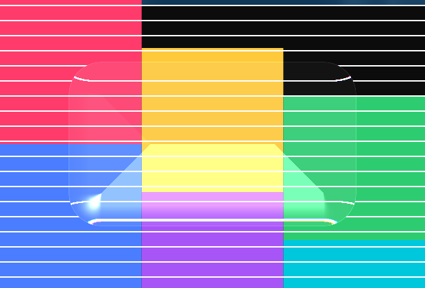

# liquid-glass-rs

Windows 上的**真·液态玻璃**渲染实验：Skia + SkSL 运行时着色器。

不是磨砂玻璃（`backdrop-filter: blur` 那种），而是**真折射**：

- 圆角矩形有符号距离场（SDF）→ 算出每个像素的边缘法线
- **斯涅尔折射定律**（`refract()`）→ 背景被真实扭曲
- **RGB 三通道色散** → 边缘出现棱镜彩边
- 方向性高光 + 边缘包边 → 玻璃的厚度感

## 当前进度

| 阶段 | 状态 |
| --- | --- |
| skia-safe 编译 | ✅ 通过（v0.156.0 + d3d） |
| SkSL 着色器编译运行 | ✅ 通过 |
| 折射 / 色散 / 高光 | ✅ 出效果（见 `liquid-glass-out.png`） |
| **无边框透明置顶窗口** | ✅ 通过（见 `window-shot.png`） |
| **桌面抓取** | ⬜ 下一步 |
| 跟手高光 / 点击穿透 | ⬜ 未做 |

现在跑的是：**真窗口 + 假背景**。背景是程序画的彩色块，
下一步用 Windows.Graphics.Capture 换成真实桌面。



## 怎么跑

```powershell
cargo run                # 开窗口（ESC 退出）
cargo run -- --offscreen # 只渲染一张 PNG
```

### ⚠️ 首次编译的坑：Skia 预编译包下不来

`skia-bindings` 会从 GitHub Releases 下预编译 Skia。本机直连失败（curl error 35 / SSL），
失败后会回退到**源码编译**，那需要 LLVM，会报 `Unable to locate LLVM installation`。

**解法**：手动下载后让 cargo 读本地文件（`file://` 协议）。

```powershell
# 1. 用镜像下载（ghfast.top / ghproxy.net / gh-proxy.com 都行）
$url = "https://ghfast.top/https://github.com/rust-skia/skia-binaries/releases/download/0.156.0/skia-binaries-ce6727ef251518df37bc-x86_64-pc-windows-msvc-d3d-ganesh-jpegd-jpege-pdf.tar.gz"
# 用浏览器或 Python 下到本地，比如 C:\tmp\skia-binaries.tar.gz

# 2. 告诉 cargo 用本地文件（注意是 file:// 两个斜杠，三个斜杠会报 os error 123）
$env:SKIA_BINARIES_URL = "file://C:/tmp/skia-binaries.tar.gz"

# 3. 编译
cargo run
```

成功后会打印 `OK -> liquid-glass-out.png`。

### 其他环境变量

国内网络下 crates 走镜像：`~/.cargo/config.toml` 里配 rsproxy。

## 技术要点

### 透明窗口怎么做的

`WS_EX_LAYERED` + `UpdateLayeredWindow`：Skia 画到内存位图 → 拷进 32 位 DIB →
一次 `UpdateLayeredWindow` 上屏。逐像素 alpha，不需要 D3D12/DirectComposition。

三个坑：

1. **`pt_dst` 必须传窗口当前位置**，否则 ULW 会把窗口挪到 (0,0)。
2. **`peek_pixels()` 拿不到数据**（返回的 Pixmap 里 `pixels()` 是 `None`），
   要用 `surface.read_pixels(&info, &mut buf, row_bytes, (0,0))`。
3. **canvas 的可变借用会挡住 `image_snapshot()`**，画背景要用 `{ }` 包住作用域。

### 下一步

1. **抓背景**：`Windows.Graphics.Capture` 抓窗口背后的桌面
   - 注意：自己的窗口会被抓进去 → 形成反馈循环
   - 解法：`SetWindowDisplayAffinity(hwnd, WDA_EXCLUDEFROMCAPTURE)` 把自己排除在捕获之外
2. **跟手高光**：鼠标位置 → `lightAngle` uniform
3. **点击穿透**：`WS_EX_TRANSPARENT`

## 许可证

**GPLv3**（见 `LICENSE`）。

着色器为原创实现，使用的是公开光学公式。设计思路参考了 WinIsland(GPLv3)、
Apple Liquid Glass 的公开设计、ios-siri-animation(MIT)，**未复制任何代码**。

如果后续引入他人 GPLv3 代码，本项目整体保持 GPLv3，符合协议。
