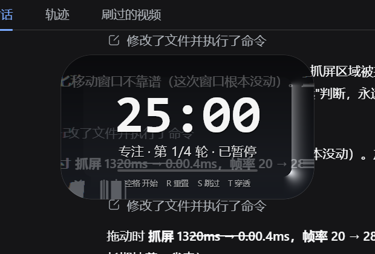

# 液态玻璃番茄钟 · Liquid Glass Pomodoro

一个跑在 Windows 上的番茄钟，外壳是**真的液态玻璃**——不是半透明图片，
是 GPU 级的折射着色器：玻璃里面是**你桌面背后的真实画面**，被边缘掰弯、
带色散、跟随光标高光，光标扫过边缘还会拖出一条液态鼓包。



> 玻璃里那些被掰弯的字，是你屏幕上的真实内容，不是贴图。

## 它是个番茄钟

| 功能 | 说明 |
| --- | --- |
| 专注 25 分钟 | 到点响两声（880Hz / 1180Hz） |
| 短休息 5 分钟 | 每完成一轮专注自动切换 |
| 长休息 15 分钟 | 每 4 轮专注来一次（和经典番茄工作法一致） |
| 进度条 | 白色=专注，薄荷绿=休息 |
| 位置记忆 | 拖到哪，下次还在哪 |

玻璃上直接显示：大号倒计时、当前阶段、第几轮、进度条、快捷键提示。

## 操作

| 按键 | 作用 |
| --- | --- |
| `空格` | 开始 / 暂停 |
| `R` | 重置本阶段 |
| `Shift + R` | 全部重置（连轮次一起清空） |
| `S` | 跳过当前阶段 |
| `T` | 点击穿透（鼠标直接穿过窗口） |
| `ESC` / 右键 | 退出 |
| 左键拖 | 移动窗口 |

按键走**两条路**：窗口有焦点时用 winit 键盘事件（快速点按也不会漏），
穿透/无焦点时用 `GetAsyncKeyState` 轮询。所以穿透模式下也能控制。

## 黑色渐变玻璃是怎么做的

两个 tint 颜色按竖向渐变混合（`tintColor` 上端近黑、`tintColor2` 下端偏蓝灰）：

```glsl
float gy = clamp((local.y + rectSize.y * 0.5) / rectSize.y, 0.0, 1.0);
float4 tint = mix(tintColor, tintColor2, gy);
glass = mix(glass, tint.rgb, tintAmount);   // tintAmount = 0.70
```

实测（真实桌面下）：玻璃内部亮度中位数 **29/255**，85% 的像素亮度 < 70 —— 够黑，
但还留着 30% 的桌面透过来。玻璃边缘因为有高光加成，会亮到 200+，那一圈就是"玻璃的边"。

## 拖动为什么不割裂了（这一版修的坑）

**症状**：拖动窗口时，玻璃里的画面会撕裂、错位，像两张图拼在一起。

**原因**：抓屏（`BitBlt`，一次 10~25ms）和上屏（`UpdateLayeredWindow`）之间，
窗口又被鼠标移走了几十像素。玻璃里显示的其实是**上一次抓屏时那个位置**的桌面切片。

**解法**：抓屏时窗口四周各多抓 120px（"带余量的背景"），把窗口相对抓屏原点的
偏移当成 uniform 传给着色器：

```glsl
glass = backdrop.eval(coord + shift + backdropOffset).rgb;
```

这样不管这一帧有没有重新抓屏，采样点永远跟着**当前**窗口位置走 —— 画面严丝合缝。
而且窗口在 120px 范围内移动时**根本不用重新 BitBlt**，拖动自然就顺了。

还有一个坑值得记下来：判断"要不要重抓"不能按"窗口是否完整落在抓好的图里"，
因为窗口贴屏幕边时抓屏区域会被夹到屏幕范围内，那个条件会**永远为真** → 每帧都重抓，
比不优化还卡。改成按"窗口相对上次抓屏移动了多远"（>120px 才重抓），既简单又不会自锁。

## 性能实测（release，620×420，联想笔记本 MX330）

| 场景 | 抓屏 | 渲染 | 上屏 | 合计 | 帧率 |
| --- | --- | --- | --- | --- | --- |
| 静止 | 6.0 ms | 32.0 ms | 0.5 ms | 39 ms | **25.5 FPS** |
| 拖动中 | 0.3 ms | 31.7 ms | 0.6 ms | 34 ms | **28 FPS** |

对比这一版之前：静止 20 FPS、拖动 20 FPS 且画面割裂。

剩下的大头是**渲染 32ms**：Skia 在 CPU 上跑 SkSL 是逐像素解释执行，约 100ns/像素
（260k 像素）。试过色散降采样、SDF 从 5 次降到 3 次、关抗锯齿，都没明显变化 ——
瓶颈在解释器本身。想上 60 FPS 得换 GPU 后端（D3D），那是下一步。

## 命令行参数

| 参数 | 作用 |
| --- | --- |
| 无 | 开番茄钟 |
| `--offscreen` | 只渲一张 PNG（测试图案背景），用于量折射 |
| `--dump-frame <路径>` | 跑 60 帧后把画面存盘退出 |
| `--time <秒>` | 指定剩余时间（验证数字渲染） |
| `--phase focus\|short\|long` | 指定阶段（验证休息配色） |
| `--blob "x,y,r;..."` | 强制指定融合小圆（最多三组） |
| `--glass-only` | 只画玻璃不画背景，PNG 的 alpha 就是玻璃轮廓 |
| `--sim-drag` | 窗口自己每帧挪一点，测"拖动时"的性能 |
| `--offset dx,dy` | 离屏渲染时给背景采样加偏移（验证采样数学） |
| `--no-exclude` | 不设 `WDA_EXCLUDEFROMCAPTURE`（调试截图用） |

## 怎么自己验证效果（都是可量化的）

```powershell
# 1) 折射：在网格测试图案上量竖线被掰弯多少
cargo run --release -- --offscreen
python tools/measure_refraction.py liquid-glass-out.png
#   期望：玻璃中心 0px，左边缘约 -8px，右边缘约 -17px

# 2) 数字有没有真的画上去
cargo run --release -- --dump-frame a.png --time 1500
cargo run --release -- --dump-frame b.png --time 5
#   两个 PNG 的数字区域应该宽度相同（等宽字体不跳字）、像素明显不同

# 3) 液态融合：看轮廓被撑开多少
cargo run --release -- --glass-only --blob "0,0,0" --dump-frame s0.png
cargo run --release -- --glass-only --blob "235,20,44;150,145,34;-150,-130,26" --dump-frame s3.png
```

`tools/measure_refraction.py` 是量折射的脚本；数字、融合、暗度都可以直接用
Pillow 数像素验出来，不靠肉眼。

## 已知限制

- **抓不到硬件加速画面**：`BitBlt` 抓不到视频播放器/游戏画面，那些区域会黑。
  要支持得换 `Windows.Graphics.Capture`。
- **不处理高 DPI**：150% 缩放下窗口会显得偏小。
- **窗口贴屏幕边时**，背景会有一侧采样到边缘像素（轻微拉伸），因为抓屏区域被屏幕夹住了。
- **帧率 25~28**：渲染受限于 Skia CPU 后端，见上面的性能说明。
- 窗口设了 `WDA_EXCLUDEFROMCAPTURE`，所以**任何截图工具都拍不到它**（防止自反馈）。
  要截图只能用程序自己的 `--dump-frame`。

## 技术栈

- **Rust** + **skia-safe 0.156**（SkSL `RuntimeEffect`）
- 窗口：`WS_EX_LAYERED` + `UpdateLayeredWindow`（逐像素 alpha）
- 形状：SDF 圆角矩形 + `smin()` 平滑并集（三个跟手小圆做液态拖尾）
- 法线：前向差分（融合后的形状没有解析梯度）
- 折射：Snell 定律 + RGB 三通道色散 + 高光 + 边缘挑亮
- 文字：Skia `Font` + Consolas Bold（等宽，倒计时不跳字）+ 阴影保证任何桌面都读得清

## 许可证

**GPLv3**（见 `LICENSE`）。

着色器为原创实现，使用的是公开光学公式。设计思路参考了 WinIsland(GPLv3)、
Apple Liquid Glass 的公开设计、ios-siri-animation(MIT)，**未复制任何代码**。
